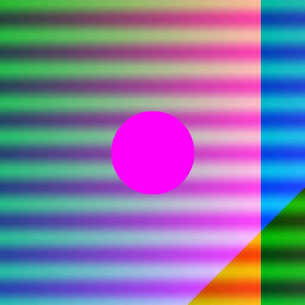
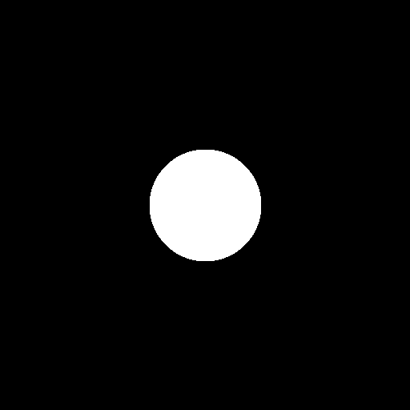
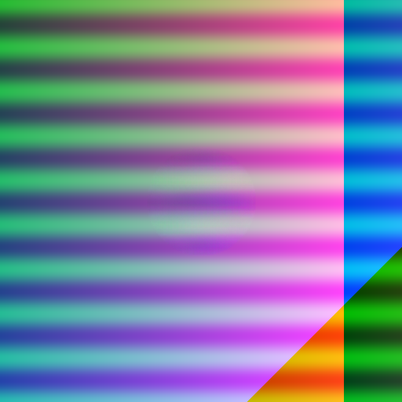

# AIE-22 — On-device Erase (LaMa on ONNX Runtime)

Unit: [#434](https://github.com/LPStruiksma/atlas-gallery/issues/434) · parent goal [#183](https://github.com/LPStruiksma/atlas-gallery/issues/183).

Erase (remove an object, a passer-by, a blemish) runs on the phone: free, offline, nothing uploaded. Prompt-driven edits ("make it sunset") stay with the hosted providers. This page records what ships and what was measured.

## What ships

- `featureaiedit/provider/local/`: `LocalEraseProvider` (an `ImageEditProvider`), the banded `LocalEraseEngine`, `OnnxLamaInpainter` (ONNX Runtime CPU, the `onnxruntime-android` 1.23.2 already in the app), `AndroidEraseImageIo` (app-private files), `LamaModelFile` (asset-part join with SHA-256 pin), and `localEraseProvider(context, outputDir)` for the later Erase UI.
- Model: OpenCV Zoo `inpainting_lama_2025jan.onnx` (LaMa big-lama, Apache-2.0), 92,591,623 bytes, bundled as two asset parts. Provenance and hashes: `app/src/main/assets/models/lama/SOURCE.md`.
- No network code on this path, no new Gradle dependency, no manifest change, no existing AI Edit file changed.

## How an erase works

1. **Mask bounds.** The mask (same size as the stored source pixels; white/opaque = erase) is scanned in 256-row bands for its exact bounding box. Empty mask: the source comes back unchanged and the model never loads.
2. **Context window.** A window around the box with context of half the mask's longer side (at least 32 px), at least 512 px per side where the image allows, shifted (not cropped) to stay inside the image. Small masks therefore run at native resolution; larger ones are area-downscaled so the longer side is 512.
3. **Model input.** Streamed in bands: area average for the image, "any covered pixel" for the mask (the hole always covers the whole object), masked pixels zeroed as in LaMa training, unused model area edge-replicated and unmasked.
4. **Inference.** One 512×512 run. The session is opened for the edit and closed after it.
5. **Write back.** Band by band at full resolution: the fill is sampled bilinearly from the model output and written **only into mask pixels**, with a 2-pixel feather inside the mask edge. Kept pixels are never written, so they stay bit-identical to the decoded source (the Android IO writes changed runs only, into an unpremultiplied bitmap, and saves PNG).

Memory is bounded by the band size plus the model, except the output bitmap itself: a 50 MP photo is one 200 MB native bitmap while the PNG is written.

## Measurements

### Model size and quality trade-off (host, x86 container, ORT 1.23.2 CPU, 4 threads)

Four synthetic scenes with known ground truth (stripes, checkerboard, blocky noise, split gradient); PSNR of the fill against the true pixels inside the hole.

| Variant | Bytes | Hole PSNR per scene (dB) | Mean | 512² inference |
|---|---|---|---|---|
| **OpenCV as shipped** (int8 weights, block 8) | **92,591,623** | 36.5 / 17.8 / 15.8 / 29.3 | **24.8** | 3.7 s |
| int8 block 32, fp32 scales | 63,420,341 | 31.5 / 17.9 / 15.4 / 28.8 | 23.4 | 3.7 s |
| int8 per output channel | 57,291,132 | 19.6 / 17.8 / 10.6 / 29.0 | 19.2 | 3.7 s |
| int4 block 32 | 48,924,014 | ≈ 6 (broken) | — | — |

Only the per-channel variant is under the unit's ~60 MB line, and it loses up to 17 dB on the stripes scene. The size stop was reported on #434 and the coordinator chose to bundle the full-quality file (same pattern as the 102.9 MB SigLIP model). An fp32 TorchScript of big-lama (205.7 MB) was also fetched, but torch could not be installed in the seat container to make a cleaner low-bit export, and Hugging Face (the Carve fp32 ONNX) is blocked there.

Host process figures (x86 container, not a phone): session load ≈ 4.7 s, 512² inference ≈ 3.7 s at 4 threads and ≈ 4.9 s at 2, peak process RSS ≈ 784 MB during inference.

### CI emulator (API 35, x86_64, `pixel_6` profile)

From `LocalEraseInstrumentedTest`, logcat tag `ATLAS_SCALE` (one JSON line per test):

| Test | Inference | Total erase | Peak RSS | Fill quality | Kept pixels |
|---|---|---|---|---|---|
| 1024×768 synthetic, 140 px disc (native 512 window) | _pending exact-head run_ | | | | |
| 8192×6144 (50.3 MP) JPEG, 680 px disc | | | | completes, no crash | |

### Phone

Not measured. Lukas's S24+ is the Exynos 2400 variant, so Qualcomm's published ~75 ms on a Snapdragon 8 Gen 2 NPU does not transfer; this build uses ORT CPU (no NNAPI) and will be timed on the phone at the first live test (#432).

## Proof images (synthetic)

512×512 crops of the 1024×768 test scene, produced on the host with the same model and the same window, feather and write-back rules (hole PSNR 31.5 dB):

| Before (object to erase) | Mask | After |
|---|---|---|
|  |  |  |

## Limits and follow-ups

- One window per erase: two far-apart marks share one window, so large separations get downscaled. Splitting into several windows is a possible follow-up if the Erase UI shows it matters.
- Very large masks are filled at ≤512 px detail and upscaled, so they look softer. LaMa's strength is large masks at 512; quality beyond that needs a refinement pass (not in this unit).
- Mask and output use the stored pixel grid (EXIF orientation not applied); the Erase UI should map brush strokes with `ImageOrientation.normalizedToOriginal`, and carrying the source's orientation onto the saved copy belongs to that wiring (#431).
- The instruction is ignored; the provider declares instruction support only because the shared validator requires it.
- Then: an Erase brush mode on the AI Edit screen (after #431) defaulting to this engine, and phone timing by Lukas (#432).
