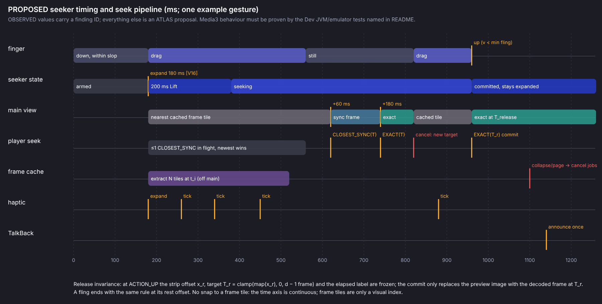
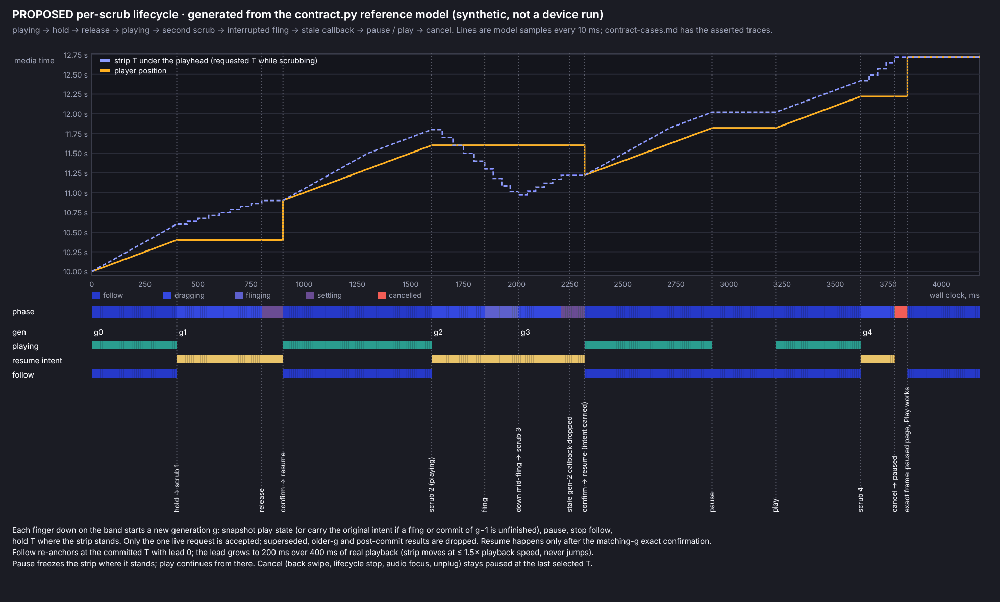
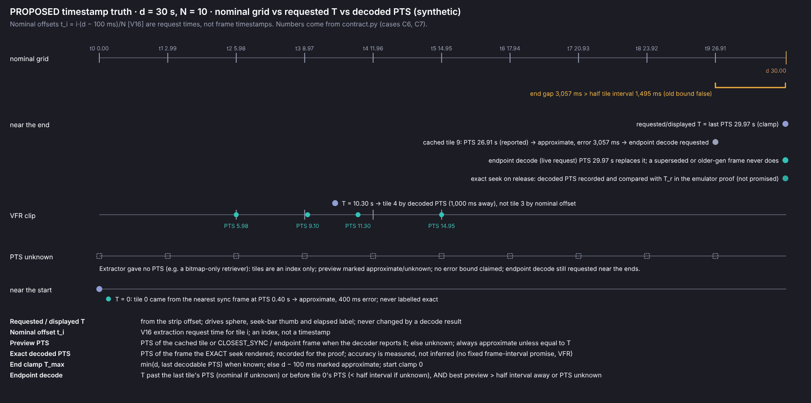

# VIDEO-V2P #979 / V2P2 #1067: proposed video frame-thumbnail seeker (pre-build evidence for #961)

**What this is:** dimensioned, annotated **proposed** overlays, a state and gesture arbitration matrix, a timing and seek diagram, and timestamp quantization limits for the VIDEO-V2 seeker of [#961](https://github.com/LPStruiksma/atlas-gallery/issues/961): hold the centred video tile in the viewer filmstrip, scrub its frames, and release at a stable position. It answers the BLOCKING [design preflight](https://github.com/LPStruiksma/atlas-gallery/issues/961#issuecomment-7075734028) (failures #1, #3, #5, #6 and #8) so a fresh `Type: design-preflight` can judge the design before anyone builds it. **V2P2 ([#1067](https://github.com/LPStruiksma/atlas-gallery/issues/1067))** corrects the two state contracts the [latest preflight](https://github.com/LPStruiksma/atlas-gallery/issues/961#issuecomment-7204108515) still failed: the [per-scrub lifecycle](#per-scrub-lifecycle-v2p2) and [timestamp truth](#timestamp-truth-v2p2). Geometry, accessibility and provenance are unchanged.

**What this is not:** an implementation, a runtime capture, a physical Galaxy S24+ measurement, or a claim about Samsung behaviour beyond the cited findings. No `app/**` file changes and no `GalleryViewer.kt` edits. All media is synthetic (a generated sun-and-boat scene with a burned-in frame counter); all artwork is clean-room (no Samsung assets).

**Base layer:** the proposed Lapis Atlas viewer target of DESIGN-8T, [`viewer-142-target`](../viewer-142-target/README.md). The generator imports that model, so the measured insets and cutouts and the proposed strip band, video row and slab come from one source. If #142's target changes, run the generator again. Note that `main` still draws the older 30×40 dp strip (`GalleryViewer.kt` `STRIP_TILE_*`). This design assumes the #142 44×56 dp strip lands first, or ships with it.

Regenerate (Python 3, no dependencies):

```bash
python3 docs/design/video-v2-scrub/generate.py   # boards, tables, and runs contract.py
python3 docs/design/video-v2-scrub/contract.py   # contract check only; exit 1 on any failed assertion
```

## Evidence status: observed, proposed, unknown

Samsung behaviour comes from the **private Samsung parity research archive** (`LPStruiksma/atlas-native`, `docs/research/samsung-rea/**`, read-only through the owner's authorized access on 2026-11-22). That archive is a **static analysis of Samsung Gallery 15.9.00.45**, not a runtime measurement. Behaviour below is paraphrased, with no Samsung code, identifiers or artwork.

| ID | OBSERVED in the archive (static analysis) | How this design uses it |
|---|---|---|
| `VIEW:V16` | Pressing the **centred** video in the filmstrip for **180 ms** expands it into a frame-thumbnail "seeker" | Hold threshold 180 ms (adopted) |
| `VIEW:V16` | The seeker shows **max(3, 7·log10(duration in s))** frame tiles (4 for a motion photo) | Frame count N (adopted; **rounding not observed**, floor proposed) |
| `VIEW:V16` | Frames are taken at even offsets **(d − 100 ms)/n**, the first at the nearest sync frame; frames that come out identical are fetched again at exact time; frames are scaled when extracted and cached under a key that includes count, size and modification | **Nominal** extraction request times t_i = i·(d − 100)/N (not frame timestamps, see [timestamp truth](#timestamp-truth-v2p2)); cache key and duplicate re-fetch adopted |
| `VIEW:V16` | Dragging the strip seeks the video as begin → visual seek → end | Seek session model (adopted) |
| `VIEW:V16` | While playing, the strip position **leads playback by 200 ms** | Follow mode lead (adopted) |
| `VIEW:V17` | Position remembered per item for the viewer session; pause on audio-focus loss and headphone unplug; on pause the current frame becomes the page image; elapsed text redraws only when the second changes | Lifecycle rows; elapsed-label update rule |
| `VIEW:V18` | Double-tap left/right seeks ∓/± 10 s, clamped | Arbitration (canvas, not strip) |
| `VIEW:V15` | Photo filmstrip with enlarged centre item, fling velocity ×1.0 | Fling physics reused; Quiet Frame replaces the enlarged centre with ring + sphere (#142) |

**The two 180 ms values are different things.** The Samsung 180 ms is the **hold threshold** that opens the seeker (`VIEW:V16`). The ATLAS 180 ms in #961/#580 is the **settle** before expensive work. This design uses both and labels each.

**Not in the archive, so PROPOSED here** (the reviewer should treat each as an ATLAS choice): seeker tile size and spacing, how the expansion animates, whether playback pauses during a scrub, fling and snap inside the seeker, end-clamp behaviour, haptic ticks, when the seeker collapses, preview pipeline timings (60 ms / 180 ms), TalkBack path, reduced-motion treatment, error and unavailable visuals. The archive also *recommends* Media3 `CLOSEST_SYNC` while dragging and `EXACT` on release. That is the researchers' recommendation, **not** an observation of Samsung, and is adopted here as a proposal.

**UNKNOWN:** live Samsung timings and visuals, gesture-navigation insets (as in #142 [GESTURE_NAV.md](../viewer-142-target/GESTURE_NAV.md)), rotation 270, foldables and split-screen, real codec frame tables on Lukas's library.

## Proposed seeker

| Rule | Value | Source |
|---|---|---|
| Entry | Finger down on the **centred** video tile and held **180 ms** within touch slop, with the pager and strip idle for ≥ 180 ms (#580 settle). Moving beyond slop first = ordinary strip drag | V16 threshold; arming rule proposed |
| Expansion | The video tile becomes **N contiguous 44×56 dp frame tiles** (one rounded 8 dp object, no inner gaps); neighbours slide outward and keep the 4 dp gap. Animated with the 200 ms Lift; cut when animations are removed | V16 count; geometry proposed (QF v3 tile size and radius) |
| Marks | 2 dp white ring with a 1 dp black keyline around the **whole** expanded video (the current item); the 8 dp `#8C9BFF` sphere stays **fixed at the playhead** (safe-width centre), 4 dp above the tiles. No label, no centre line, no time bubble | QF v3 marks; removal list |
| Time axis | Continuous: requested T = (playhead x − span left)/span width · d, clamped to [0, T_max] ([end clamp](#timestamp-truth-v2p2)). Tiles are a visual index, not snap points | Proposed |
| Drag | 1:1 with the finger across the whole 76 dp band (one drag target, full safe width). Every finger down starts a scrub generation that pauses and snapshots play state; resume only after exact confirmation ([lifecycle](#per-scrub-lifecycle-v2p2)) | Proposed |
| Fling | Platform spline decay ×1.0 inside the span, clamped at both ends without bounce, **no snap** | V15 fling ×1.0 reused; clamp proposed |
| Ends | At 0:00 and at T_max further drag does nothing. No pager hand-off while expanded | Proposed |
| Haptic | One light tick on expansion, then one when the playhead crosses a frame-tile boundary (≤ 1 per vsync); never per pixel | Parity §0 tick rule applied to frames |
| Video row | Elapsed label shows T and redraws only when the second changes; the seek bar thumb mirrors T; play glyph shows paused | V17 label rule; #142 row |
| Collapse | On page change, chrome hide, viewer exit, lifecycle stop or a tap on a neighbour tile (which also selects that item). While the same video stays current and chrome is shown, the seeker stays expanded and follows playback, with the 200 ms lead reintroduced only as playback advances ([lifecycle](#per-scrub-lifecycle-v2p2)) | V16 lead; persistence and ramp proposed |
| Short video | d < 300 ms: no seeker; the hold does nothing (no tick) | Proposed |

## Overlays (annotated, inspectable SVG)

Every board shows the measured safeDrawing (teal), system bars (blue), cutout (red), the proposed semantic hits (pink dashed), the playhead and the preview (orange), plus an annotation panel with the numbers. The viewer is `#000` in both themes (QF v3), so **light and dark boards differ only in the media**: light boards use bright synthetic frames and dark boards dark frames, which are the real contrast extremes for the ring and sphere.

| Viewport | safeDrawing L/T/R/B dp (MEASURED, three-button) | Boards |
|---|---|---|
| S24+ portrait 1080×2340 px = 384×832 dp, rotation 0, cutout top centre | 0 / 44.44 / 0 / 48 | [light held](svg/portrait-3button--light--held.svg) · [light dragging](svg/portrait-3button--light--dragging.svg) · [dark held](svg/portrait-3button--dark--held.svg) · [dark dragging](svg/portrait-3button--dark--dragging.svg) · [dark unavailable frames](svg/portrait-3button--dark--unavailable.svg) · [dark 1:23:45 at 200% font](svg/portrait-3button--dark--long-font200.svg) · [states](svg/portrait-3button--states.svg) |
| Physically rotated 2340×1080 px = 832×384 dp, rotation 1, cutout left, nav bar right | 44.44 / 24.18 / 48 / 0 | [light held](svg/landscape-3button--light--held.svg) · [light dragging](svg/landscape-3button--light--dragging.svg) · [dark held](svg/landscape-3button--dark--held.svg) · [dark dragging](svg/landscape-3button--dark--dragging.svg) · [dark unavailable](svg/landscape-3button--dark--unavailable.svg) · [dark long 200%](svg/landscape-3button--dark--long-font200.svg) · [states](svg/landscape-3button--states.svg) |
| Narrow landscape 640×360 dp (COMPUTED from the rotated insets) | 44.44 / 24.18 / 48 / 0 | [light held](svg/landscape-narrow-computed--light--held.svg) · [light dragging](svg/landscape-narrow-computed--light--dragging.svg) · [dark held](svg/landscape-narrow-computed--dark--held.svg) · [dark dragging](svg/landscape-narrow-computed--dark--dragging.svg) · [dark unavailable](svg/landscape-narrow-computed--dark--unavailable.svg) · [dark long 200%](svg/landscape-narrow-computed--dark--long-font200.svg) · [states](svg/landscape-narrow-computed--states.svg) |

PNG renders of every SVG are in [`png/`](png/) (headless Chromium at 2 px per dp, quantized to 128 colours to keep the repository small; the SVGs are the source). Geometry checks for all 18 boards are in [tables.md G1](tables.md): the drag target is ≥ 48 dp in both directions, inside safeDrawing, off the cutout, with no collision with any other hit; the video row sits 12 dp above the band and the band 8 dp above the slab on every board; the gesture-exclusion rectangle is the 76 dp band (under Android's 200 dp per-edge cap). The mandatory bottom gesture zone is never excluded.

## State and gesture arbitration matrix

Precedence, highest first. "Owner" is who consumes the pointer stream from its first down until up or cancel; a stream never changes owner except where a row says so.

| # | Situation | Owner and outcome |
|---|---|---|
| 1 | System edge or mandatory gesture zone (back swipe, home bar) | System. The band requests exclusion only while chrome is shown; the mandatory zone is never excluded. A back swipe during a scrub arrives as ACTION_CANCEL → row 14 |
| 2 | TalkBack exploration on | Accessibility path (see below); the hold gesture is never required |
| 3 | Finger down on the band, centred video tile, held 180 ms within slop, pager and strip idle ≥ 180 ms | **Seeker** opens. Second pointers anywhere are ignored until up |
| 4 | Finger down on the band and moved past slop before 180 ms | Ordinary strip scrub (photo rules, #142); the seeker never opens on that stream |
| 5 | Finger down on the band while a fling or the 260 ms tap ease is running | Stops the motion (V14 rule); a fresh 180 ms hold is needed to open the seeker |
| 6 | Seeker open: horizontal drag / fling on the band | Seek (T moves); no pager, no chrome toggle, no zoom |
| 7 | Seeker open: finger down during a seeker fling, or while a commit is settling | New scrub generation: stops the span where it is; that point becomes the drag origin; the **original** resume intent transfers; the older generation's callbacks are dropped; no seek committed until release |
| 8 | Seeker open: tap on a neighbour tile outside the span | Selects that item (48×76 cell), collapses the seeker, keeps the video's position per item (V17) |
| 9 | Video canvas hold while playing (#580 2× hold) | Canvas. Never opens the seeker; the strip hold never triggers 2×. If 2× is active, a finger on the strip is a second pointer and is ignored |
| 10 | Video canvas double-tap (#580 brief: left 35% −10 s, right 35% +10 s, centre zoom) | Canvas; V18 step. If the seeker is open it stays open and its span jumps to the new T without animation |
| 11 | Canvas horizontal swipe (pager) | Pager. Collapses the seeker after the page settles; the old video's position is remembered |
| 12 | Canvas pinch / pan while zoomed | Canvas zoom; the seeker stays as it is and does not move |
| 13 | Single tap on canvas | Toggles chrome after the double-tap timeout; hiding chrome collapses the seeker (position kept) |
| 14 | ACTION_CANCEL, lifecycle pause/stop, audio-focus loss or headphone unplug during a scrub (dragging, fling or settling) | Keep the **last selected T** (never revert, never jump), stay paused (resume intent dropped), exact-seek the paused frame to T, collapse. V17 pause rules apply |
| 15 | Orientation change while open | Seeker state (open, T, was-playing) is saved; it reopens at the same T in the new geometry with no animation |
| 16 | Frame tile not yet extracted or extraction failed | Pending: video poster under a 45% black veil; failed: mist `#14152A` tile, no glyph or text. Seeking still works through the player; the main view keeps the last valid preview until a matching-generation frame lands |
| 17 | Decoder/player error before the hold | Hold does not open the seeker; the page shows #142's error state; strip acts as a photo strip |
| 18 | Decoder error mid-scrub, or the release's exact seek fails | Main view keeps the last good preview, still marked approximate; stays paused at T_r (no resume); the seeker collapses; #142 error state; position kept |
| 19 | Rapid navigation (pager or strip moving, or < 180 ms since rest) | Seeker cannot arm; no player work starts for pass-through videos (#580 settle rule) |
| 20 | Reduced motion (remove animations) | Expansion, collapse and preview cross-fades cut instantly. Drag and fling stay, because they are direct manipulation; seek itself is never removed |
| 21 | 200% font | No text in the strip. Only the video row reflows (#142 F3, labels above the bar); band geometry is unchanged ([long 200% boards](svg/portrait-3button--dark--long-font200.svg)) |

The per-state visuals (23 rows, including settling, confirmed follow, second scrub, cancelled and exact-decode failure) are on each viewport's states board, for example [portrait states](svg/portrait-3button--states.svg).

## Timing and seek pipeline



Source: [svg/timing.svg](svg/timing.svg). Rules:

1. **Moving** (finger or fling): every vsync maps the span offset to T. The main view shows the cached frame tile **nearest by decoded PTS** scaled up (low-res, approximate). If the extractor gave no PTS, the tile is marked approximate/unknown and no error bound is claimed; there is no fixed ‘half a tile interval’ bound (it is false at the end, see [timestamp truth](#timestamp-truth-v2p2)). The player receives at most one `CLOSEST_SYNC` seek in flight; a newer target replaces the queued one. No full-screen recomposition: T is read only by the overlay image, the seek-bar thumb and the elapsed label.
2. **60 ms still:** the main view switches to the decoder frame from a `CLOSEST_SYNC` seek to T, if its generation and request still match. It is sharp but it is a **sync** frame: its distance from T depends on the file's GOP layout and is not bounded by this design. Its PTS is used as reported, or treated as unknown. The elapsed label keeps showing T.
3. **180 ms still:** an `EXACT` seek to T decodes the frame at T. Expensive work (audio preparation, neighbour prefetch) is allowed only from here.
4. **Cancellation:** any new movement cancels the pending 60 ms and 180 ms timers. A new seek supersedes an in-flight one. Collapsing, a page change or leaving the viewer cancels the frame-extraction jobs and evicts their pending keys.
5. **Release invariance:** at ACTION_UP (velocity below the minimum fling) the strip offset x_r, T_r = clamp(map(x_r), 0, T_max) and the elapsed label are frozen and follow stays off. Commit = `EXACT` seek to T_r; resume (if the scrub's intent is playing) only after the matching-generation exact confirmation, then follow re-anchors at T_r with lead 0. Nothing in the strip moves on release or on resume; only the preview image may sharpen. A fling ends with the same rule at its rest offset. Full contract: [per-scrub lifecycle](#per-scrub-lifecycle-v2p2).
6. **TalkBack:** one polite announcement of the position, for example "0:19 of 0:30, paused", 180 ms after the playhead comes to rest. No per-frame or per-tick speech.

## Per-scrub lifecycle (V2P2)



Source: [svg/lifecycle.svg](svg/lifecycle.svg), drawn from a run of the reference model in [`contract.py`](contract.py); asserted cases and event traces in [contract-cases.md](contract-cases.md). All values are PROPOSED except the 200 ms lead (`VIEW:V16`).

**State per viewer page:** scrub generation `g` (monotonic), resume intent, requested T, phase (`follow`, `dragging`, `flinging`, `settling`, `cancelled`, `error`) and a follow anchor (T_c, p_c, L0). Every async request (CLOSEST_SYNC preview, endpoint decode, EXACT commit) carries `g`, a request sequence number and its target T.

| Step | Contract |
|---|---|
| **Begin** | A scrub begins on (a) the initial 180 ms hold, (b) a finger down on the open seeker (re-drag, including while playing), (c) a finger down during a seeker fling, (d) a finger down while the previous commit is settling. Each begin increments `g`. |
| **Snapshot** | (a)/(b): resume intent = whether playback is playing now. (c)/(d): the unfinished previous scrub's **original** intent transfers unchanged; the player is already paused by that scrub, so it is never re-sampled, upgraded or lost. |
| **Pause** | Pause synchronously at begin; follow stops for the whole scrub (dragging, fling, settling). A play/pause tap during a drag is a second pointer and is ignored (matrix row 3). |
| **Visual target** | Requested T = where the strip already stands (including any follow lead). The strip never jumps to the player position on begin. |
| **Release / settle** | Release or fling rest sends `EXACT(T_r)` tagged `g`. Offset, T_r and the elapsed label stay frozen until confirmation. |
| **Commit confirmation** | Only an exact-seek result whose `g` and target match the live scrub confirms. Then: player position = T_r; follow anchors at T_c = T_r with lead 0; playback resumes **only now**, and only if the intent is playing. |
| **Follow continuity** | Strip T = T_c + Δ + lead(Δ), with Δ = actual playback advance since the anchor and lead(Δ) = L0 + (200 − L0)·min(1, Δ/400 ms). The lead grows from 0 to 200 ms over the first 400 ms of real playback, so the strip moves at ≤ 1.5× playback speed and **never applies a +200 ms jump**. While playback does not advance (buffering, paused), the strip does not move. |
| **Pause / play while following** | Pause freezes the strip where it stands (no backward jump); play continues from that lead. Play during settling sets the intent to playing and resumes after confirmation, not before; pause during settling clears it; the commit still completes. |
| **Request ownership (stale callbacks)** | At most one preview request is **live**: issuing a CLOSEST_SYNC or endpoint request supersedes every earlier one, of any generation, so a superseded request is dropped even on its *first* arrival and even within the same generation; each live request is accepted once. Preview results are accepted only while dragging, flinging or settling. Exact confirmation, cancel and error **invalidate** all preview requests, so no late preview can ever replace the exact frame or the playback frame. Exact results are accepted only for the one live exact token (same `g`, same target) and only once; anything else is dropped and can never resume playback or move the strip. Content-keyed tile extraction may still fill the cache, but only the selection rule decides what the main view shows. |
| **Cancel** | ACTION_CANCEL (back swipe), lifecycle stop (backgrounded), audio-focus loss or headphone unplug during dragging, fling or settling: stay paused at the last selected T, drop the resume intent and the pending commit, exact-seek the paused frame to T (never a resume), collapse. When that seek lands the page is an **ordinary paused page** at T: the seeker is collapsed and the normal Play control works again with no new scrub. A Play tap made while the cancel's seek is pending starts playback from T once it lands, not before; a late result of the cancelled scrub's own commit, or a duplicate, is dropped. When not scrubbing, these events pause playback (V17) and freeze the strip; on return the page is paused at the remembered position (V17), seeker collapsed, and Play resumes from there. |
| **Exact decode fails** | Stay paused at T_r, keep the last preview and keep it marked approximate (never presented as exact), no resume, collapse, #142 error state (matrix row 18). **Unlike cancel**, Play is not offered as recovery: the #142 error state owns retry, which reloads the player at T_r. A slow decode just keeps settling; a new finger down supersedes it as in (d). |
| **Unchanged** | Continuous no-snap drag, clamped fling without bounce, reduced-motion direct manipulation (row 20), the 60/180 ms settle timers and no new chrome. |

Concrete acceptance examples (each asserted in [contract-cases.md](contract-cases.md)):

- **C1 repeat scrub:** playing at 10 s → hold (g1, intent playing, pause, strip stays put) → drag issues requests A then B; A arriving first *after* B was issued is dropped, B is accepted once → release → settling (strip and T frozen, paused) → confirmation → resume with strip = T_r exactly (no +200 ms) → a late preview cannot replace the committed frame → lead reaches 200 ms after 400 ms of playback with no per-frame step above 24 ms → second scrub while playing (g2, fresh snapshot, pause, strip stays put) → a duplicate of g1's confirmation is dropped → g2 commits at its own T and resumes.
- **C2 interrupted fling:** playing → scrub A → fling → finger down mid-fling → scrub B carries intent *playing*, T held where the fling stopped, player never resumed between A and B, A's late and older preview callbacks dropped → B confirms → resume. The paused variant carries intent *paused* and stays paused.
- **C3 down during commit:** same-generation results out of order (newer seq 2 accepted, older seq 1 dropped) → release → EXACT pending → finger down → the late g1 confirmation is dropped (no premature resume) → g2 commits and resumes.
- **C4 pause/resume/cancel/background:** pause during settling stays paused after commit; play from paused follow is continuous; play during settling resumes after confirmation only; pause while following freezes the strip and play continues without a jump; audio-focus loss mid-drag stays paused at the last selected T, a late preview is dropped, its exact frame never resumes and a duplicate is dropped; then ordinary Play works without a new scrub; Play tapped while a cancel's seek is pending plays from T only once it lands; backgrounding while following pauses and freezes the strip and Play on return resumes from the remembered position; backgrounding mid-commit drops the scrub's own confirmation.
- **C5 exact decode fails:** stays paused at T_r with the preview still marked approximate; Play does not recover (the #142 error state owns retry); a late preview is dropped.

## Timestamp truth (V2P2)



Source: [svg/timestamps.svg](svg/timestamps.svg), numbers from `contract.py` cases C6–C7 and table E1 in [contract-cases.md](contract-cases.md).

Four different times, never mixed up:

| Time | Meaning | Rule |
|---|---|---|
| **Requested / displayed T** | From the strip offset; drives the sphere position, seek-bar thumb and elapsed label | Changed only by the finger, fling or follow; never by a decode result |
| **Nominal offset t_i** | `VIEW:V16` extraction request time i·(d − 100 ms)/N | A request and an index into the strip, **not** a frame timestamp |
| **Preview PTS** | PTS of a cached tile, a CLOSEST_SYNC frame or an endpoint frame, when the decoder reports it | Selection uses actual decoded PTS where known. If the extractor returns no PTS (for example a bitmap-only retriever), the preview is marked approximate/unknown and no PTS is inferred from t_i |
| **Exact decoded PTS** | PTS of the frame rendered by the `EXACT(T_r)` seek | Recorded and compared with T_r in the emulator proof; accuracy is measured, not inferred from the Media3 request mode |

**Endpoint case.** The grid stops short of the end: for d = 30 s, N = 10 the last nominal tile is 26.91 s, while the last frame of a 30 fps clip is at 29.97 s, a 3,057 ms gap against a half tile interval of 1,495 ms. Every duration in table E1 has an end gap above half an interval (1:23:45: about 201 s). So:

- **Endpoint fallback:** request an endpoint-specific decode at T through the preview pipeline (cache-only; nothing is added to the strip) when T is in an **end region** and the best preview is farther than half a tile interval from T or has an unknown PTS. End region: T > the last tile's decoded PTS (its nominal offset when the PTS is unknown). Start region: T < tile 0's decoded PTS; when tile 0's PTS is unknown, T < half a tile interval (the sync frame it came from may sit anywhere near the start). Examples (C6, C7; d = 30 s, N = 10): T = 28.0 s with tile 9 at PTS 26.91 s is 1,090 ms away, so no decode; T = 28.5 s is 1,590 ms away, so decode; with all PTS unknown, T = 28.0 s and T = 0 both decode and T = 10.3 s does not; T = 0 with tile 0 at PTS 2.0 s decodes.
- **Stale decoder behaviour:** until the live request's sharper frame arrives, the main view keeps the last valid preview, marked approximate. A frame from an older generation or a superseded request never replaces it, and nothing silently changes the requested T or presents an approximate PTS as exact.
- **Start:** tile 0 is taken at the nearest sync frame (V16), which may sit after 0 (for example PTS 0.40 s): T = 0 then shows it as approximate with a 400 ms error, never as exact.

**End clamp.** T_max = min(d, last decodable PTS) when the track's last sample time is known (from the extractor or an endpoint decode). If it is unknown, T_max = d − 100 ms (the V16 tail reused as a conservative margin) and the clamp is marked approximate. The start clamp is 0. There is no fixed ‘d − 1 frame’ rule, because VFR clips have no single frame interval.

**Clip kinds.** VFR: select by decoded PTS, which can differ from the nominal-nearest tile (C7: T = 10.30 s picks tile 4 at PTS 11.30 s, not tile 3 at nominal 8.97 s); no frame-interval accuracy promise. Missing PTS: tiles are an index only, all previews approximate/unknown, endpoint decode still requested. Short clips (d = 300 ms): N = 3, the last nominal tile is at 133 ms and the end gap is 133 ms. Long clips (1:23:45): tile interval about 201 s, so the moving preview can be minutes away until the 60 ms sync frame lands; it is marked approximate, never exact.

## Timestamp quantization and decoder limits

Full table: [tables.md Q1](tables.md). Drag resolution is span px ÷ duration on the 2.8125 px/dp target.

| Duration | N | Span | ms per px | Practical limit |
|---|---|---|---|---|
| 1 s | 3 | 132 dp | 2.7 | Decoder frames (one px < one 60 fps frame) |
| 4 s | 4 | 176 dp | 8.1 | Decoder frames |
| 30 s | 10 | 440 dp | 24.2 | Both (between one 60 fps and one 30 fps frame per px) |
| 2 min | 14 | 616 dp | 69.3 | Strip pixels (one px skips ~2 frames at 30 fps) |
| 1:23:45 | 25 | 1100 dp | 1,624 | Strip pixels (one px ≈ 1.6 s) |

What the design promises, and what it does not:

- **Settled frame:** the frame Media3 `EXACT` renders for T_r. The design promises no fixed error: the actual |exact decoded PTS − T_r| is measured in the emulator journey (below) and recorded, never inferred from the request mode. VFR clips get no frame-interval promise at all.
- During movement and the 60 ms preview, previews are approximate. Their error is known only where the decoder reports a PTS; there is no tile-interval or GOP bound (see [timestamp truth](#timestamp-truth-v2p2)).
- For long videos, drag alone cannot select single frames (one px ≈ 1.6 s at 1:23:45). The seek bar and the TalkBack adjustable step are the finer paths; the design does not claim per-frame drag on long videos.
- Tiles are requested at the nominal offsets at the tile size (124×158 px); tile 0 is taken at the nearest sync frame (V16). If two tiles decode identical, the second is fetched again at exact time (V16). The extractor must report each tile's decoded PTS where it can; a bitmap-only path such as `getScaledFrameAtTime` reports none, so its tiles are PTS-unknown.

## Accessibility

- **TalkBack:** the video tile in the strip exposes a custom action "Seek through frames". It opens the seeker as an adjustable node: swipe up or down steps one frame tile (d/N) and the node reads "Frame 4 of 10, 0:12 of 0:30". The existing seek bar stays adjustable for fine steps. Play state is announced only when it changes. TalkBack order stays as in #142 (video row play → seek → filmstrip).
- **48 dp:** the seeker's single drag target is the full band (≥ 384×76 dp portrait); neighbour tiles keep their 48×76 cells.
- **Reduced motion and 200% font:** see matrix rows 20 and 21.
- **Contrast:** the ring and sphere use #142's keylined marks (≥ 21:1 and ≥ 8.25:1 against white or black frames, per #142 T4).

## Proof Dev still owes (pre-merge, not this unit)

- JVM: frame count and nominal offsets for d = 0, 99, 100, 300, 1 s, 4 s, 30 s, 1:23:45; T clamp at both ends (known and unknown last PTS); offset → time mapping; cancellation of the 60/180 ms timers; release invariance (offset, T and label unchanged by the commit); arbitration rows 3–14 as gesture-state tests; **Kotlin equivalents of contract cases C1–C7** (generations, intent transfer, no resume before matching confirmation, no +200 ms jump, stale and out-of-order callbacks, cancel, decode failure, endpoint fallback, VFR and unknown PTS).
- Emulator: a generated synthetic video with a burned-in frame counter (as drawn here); hold 180 ms → assert N tiles; drag to a target → release → record the decoded frame's counter/checksum, its PTS and `currentPosition`, and report |PTS − T_r| (acceptance target for the CFR fixture: within one frame interval, measured; VFR: recorded only); repeat scrub while playing and assert no strip jump at resume; both endpoints with the endpoint decode; an exact-seek failure fixture; light/dark exact-head captures in portrait and rotated landscape, including 200% font and an unavailable-frame fixture.

## Choices for the preflight reviewer

| # | Choice | Proposed | Alternative |
|---|---|---|---|
| P1 | Time axis inside the seeker | Continuous, no snap | Snap to frame tiles (coarser, more Samsung-strip-like, but quantizes T to d/N) |
| P2 | Playback during a scrub | Pause at every scrub begin; resume only after the matching exact confirmation, with the original intent carried through interrupted flings and commits | Keep playing at the scrubbed position |
| P3 | Seeker after release | Stays open while the same video is current and chrome is shown; follows playback from the committed T, ramping the 200 ms lead in over 400 ms of real playback | Collapse on release |
| P4 | Fling under reduced motion | Keep (direct manipulation) | Drop momentum entirely |
| P5 | Frame rounding of 7·log10(d) | Floor | Round to nearest (one more tile for some durations) |

## What was executed for V2P2 (#1067)

- `python3 docs/design/video-v2-scrub/generate.py`: regenerated every SVG, `geometry.json` and `tables.md`, and ran the contract check (70/70 assertions pass after Review round 2; 50/50 in round 1, output in [contract-cases.md](contract-cases.md)).
- PNGs of the changed boards rendered with headless Chromium at 2 px per dp and quantized to 128 colours; portrait, rotated and narrow states boards, the timing board and the two new boards were opened and checked for clipped or overlapping text.
- **Not executed:** any Android, Media3, emulator or device run. The model is a Python reference of the written contract, not a validation of runtime behaviour; the production proof on #961 is still owed.
