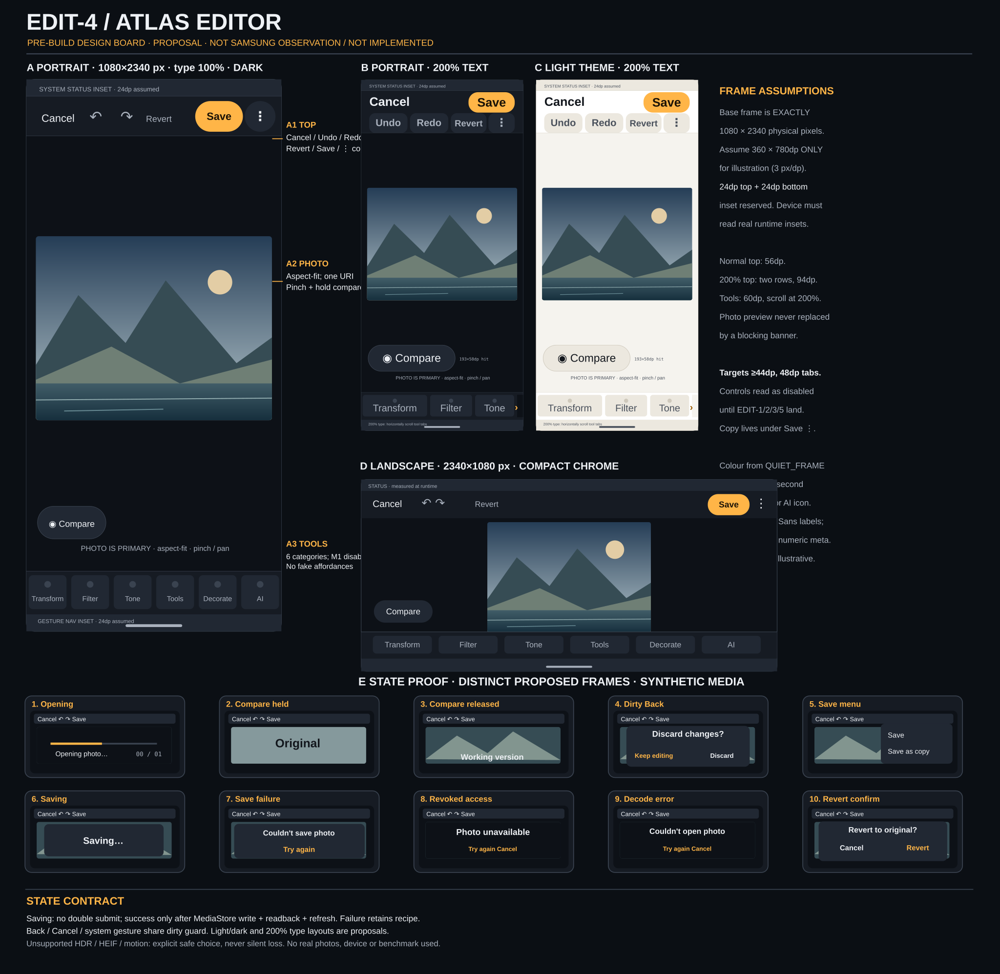

# EDIT-4 · Atlas Editor pre-build design proof

**Status:** proposed ATLAS UI, **not implemented**; no S24+ observation, emulator render, or Samsung-equivalence claim. This board corrects the evidence gaps identified in [EDIT-4 design-preflight](https://github.com/LPStruiksma/atlas-gallery/issues/634#issuecomment-7027484440). All imagery is synthetic, all fonts in the SVG are illustrative fallbacks. Use the approved [Quiet Frame v2 / Meridian specification](../design/QUIET_FRAME.md) for actual token-backed Compose typography, colours and icon strokes. The source [EDIT-0 ledger](PARITY.md) grades uncertified Samsung placements as **D**, not observed.

## One-screen task and geometry

**Task:** while viewing a photo, tap the pencil and see **that same, correctly oriented photo** as the primary object in Atlas Editor, then edit through a unified recipe with explicit Save / Save as copy or safe exit. The [owner's words and exclusions](https://github.com/LPStruiksma/atlas-gallery/issues/634) still bind: central editor, no extra viewer AI icon/banner, no Samsung proprietary material, no video editor before M6, no fake working tools.

The main frame in the SVG is **exactly 1080 × 2340 px** in its local coordinate system. For design arithmetic only, it uses **3 px per dp**, or **360 × 780 dp**, with hypothetical 24 dp top and 24 dp gesture-bottom insets. **Do not hardcode these insets:** apply runtime WindowInsets on the actual Android device and re-render for its display/font scaling before implementation acceptance.

| Region (portrait frame coordinates) | Base 100% | Large 200% | Contract / tap path |
| --- | --- | --- | --- |
| System status | y=0–72 px (24 dp assumed) | same | never overlay or consume system insets |
| Top actions | y=72–240 px (56 dp) | y=72–354 px (94 dp, two rows) | ≥44 dp target boxes; accessible Cancel, Undo, Redo, Revert when applicable, Save and **separate** Save-adjacent ⋮; horizontal layouts reflow, never tiny labels |
| Preview | y=240–2086 px | y=354–2086 px | flexible remaining space, full photo aspect-fit at idle, bounded pinch/pan; center illustration is a generated synthetic landscape; first-photo-pixel budget ≤300 ms, **not measured** here |
| Accessible comparison | button x≈47–337, y≈1810–1948 px | same available region | visible labeled Compare for keyboard/TalkBack, with alternate press-and-hold on image; releases to working version without changing recipe |
| Bottom tool categories | y=2086–2268 px (≈61 dp) | same, scroll horizontally for long enlarged names | Transform, Filter, Tone/Adjust, Tools, Decorate, AI; category hit targets ≥48 dp; nonfunctional M1 tools visibly disabled, not fake working buttons |
| Gesture navigation | y=2268–2340 px | same | system gesture inset kept free, no global app nav pill in the editor |

**Top actions and overflow.** Save remains the primary amber-filled action. The adjacent ⋮ menu contains the explicit **Save as copy** action. In the large-text state, Revert and ⋮ are separate 44 dp-or-larger controls in the second row; no overlapping hit boxes. Undo/Redo are disabled unless available. Revert is enabled only when an Atlas original backup exists. The final implementation must ensure each target and its focus node are at least 44 dp, including in landscape. High contrast, focus order and content descriptions must survive 200% fonts. At screen width below this design arithmetic or under extra-large accessibility text, the app may further reflow into a safe action sheet without removing Cancel or Save.

**Preview priority.** No permanent sliders in M1 idle. An active M2–M5 tool can open a temporary substrip (reference height 96–160 dp) under the preview; it must compress the *tool area* and adapt to landscape before sacrificing the visible working photo. For large type, landscape and later text-keyboard interactions, the editor keeps the media visible and Save/Back reachable. Touching a transform handle wins over compare until gesture ownership is resolved. Photo zoom/pan changes viewport state only, not the edit recipe.

**Meridian identity.** Use existing semantic `ground/surface/raised/line/ink/ink-muted/accent/accent-fill/on-accent` tokens; no literal colour constants added to UI code. The dark proposal uses the spec's dark ground and amber fill; the light variant uses the approved light token family. Actual implementation must use Instrument Sans for UI labels, IBM Plex Mono for numbers/metadata, the 1.5 dp icon stroke and approved radii; the board substitutes generic glyphs because this is a wireframe. There is **no new meridian timeline/rail** in the editor: the rail signature is defined for existing grid, viewer filmstrip, bottom nav and loading surfaces, not a justification to add viewer-like editor chrome. Runtime light/dark renders at exact head are required before merge.

## Navigation and state board

The board's ten distinct thumbnails are **different proposed states**, not a performance or behavioral test. They specify copy and layout for Review; show them as real Compose screenshots for pre-merge evidence.

| Board frame | Entry / observable outcome | Safety, feedback and exit |
| --- | --- | --- |
| 1 Opening | pencil passes focused content URI; progress along hairline over existing background | first non-placeholder correctly oriented photo ends open stopwatch; no library-wide scan, cancel remains reachable |
| 2 Compare held | hold photo or accessible Compare exposes original | no recipe mutation, original stays aspect fit |
| 3 Compare released | release immediately returns working version | zoom/scroll retained; comparison never saves |
| 4 Dirty Back | Cancel, gesture Back or system Back with pending recipe shows **Discard changes?** | actions **Keep editing** (default, preserves recipe) and **Discard**; clean Back returns directly |
| 5 Save menu | Save and **Save as copy** are distinct | copy never overwrites original; return to same viewer/filmstrip position |
| 6 Saving | **Saving…** visibly suspends Save and Save as copy | suppress duplicate submit; success only after MediaStore write, readback and refresh |
| 7 Save failure | **Couldn't save photo** and **Try again** | recipe remains intact; retry, copy or cancel safe; consent rejection is a failure not success |
| 8 Revoked/partial access | **Photo unavailable** with **Try again** / **Cancel** | no crash, no deletion; do not pretend previous permission remains |
| 9 Decode error | **Couldn't open photo** with **Try again** / **Cancel** | do not substitute a neighboring photo or show empty editor as success |
| 10 Revert | confirmation **Revert to original?**; Cancel / Revert | restore byte-for-byte Atlas backup only after safe write and verification; no silent destructive fallback |

Other acceptance states to render on an **exact implementation head**: save success returning to viewer, scoped-write consent declined, invalid item, no-edit history, zoomed preview, AI tab disabled then enabled only once EDIT-5 adapters work, original/working toggled, landscape with pending modal, RTL, TalkBack focus traversal, large-type on bright/dark synthetic photos, and keyboard open when M4 text arrives. Unknown HEIF / HDR gainmap / motion-photo output must show a safe, explicit resolution rather than stripping data silently.

## Handoff and independence gates

- **Viewer photo pencil:** opens Atlas Editor for the currently focused media URI. Viewer More gets exactly **Open in Samsung editor**, retaining the documented [ACTION_EDIT → ACTION_VIEW → resolver fallback](../SAMSUNG_EDITOR_HANDOFF.md), including scoped-grant and failure handling. Videos keep the Samsung path through M6. Do not add viewer AI chrome or create a video pencil where none existed.
- **M1 enabling:** the rendering surface can open with disabled M2–M5 category placeholders. EDIT-5's AI Edit and Face Swap share **one AI category** but must stay disabled until their real adapters exist; no fake tool dialog. Route camera-URI ownership and viewer More call-site with the integrator.
- **Dependencies:** [EDIT-1 #631](https://github.com/LPStruiksma/atlas-gallery/issues/631) (recipe), [EDIT-2 #632](https://github.com/LPStruiksma/atlas-gallery/issues/632) (renderer), [EDIT-3 #633](https://github.com/LPStruiksma/atlas-gallery/issues/633) (safe Save/Revert) are required before dispatch to Dev for the complete EDIT-4 shell. [BRAND-2 #638](https://github.com/LPStruiksma/atlas-gallery/issues/638) supplies runtime Meridian tokens. The passed pre-build design gate alone does not dissolve those dependencies.
- **Pre-build review:** use [rubric](https://github.com/LPStruiksma/autodev/blob/main/docs/design/rubric.md) checks #1–#6, #7 Verdict and #8 Identity; compare A–E board against owner intent, copy and each stated state. This is an annotated mockup, not a real screenshot. If any needed frame is still incomplete, give a specific failing check.
- **Pre-merge proof:** exact-head emulator snapshots at 1080×2340 in both themes and 100%/200% text, landscape/insets and modal states, plus pixel-to-open trace **10 cold + 10 warm** against [≤300 ms budget](BUDGETS.md), signed readable Save/copy/Revert tests, [PhotoEditorHandoff](../SAMSUNG_EDITOR_HANDOFF.md) fallback tests, exact-head CI, and separately labeled S24+ canary results when available. No local Node, Android build, Gradle, emulator or device checks were run during this Strategy documentation turn.

**Design decision status:** request a fresh `Type: design-preflight` on [issue #634](https://github.com/LPStruiksma/atlas-gallery/issues/634) using this board and its SVG. Review's earlier `Design: BLOCKING` remains valid for the prior brief; this artifact is a proposed correction, **not** a self-awarded PASS.
