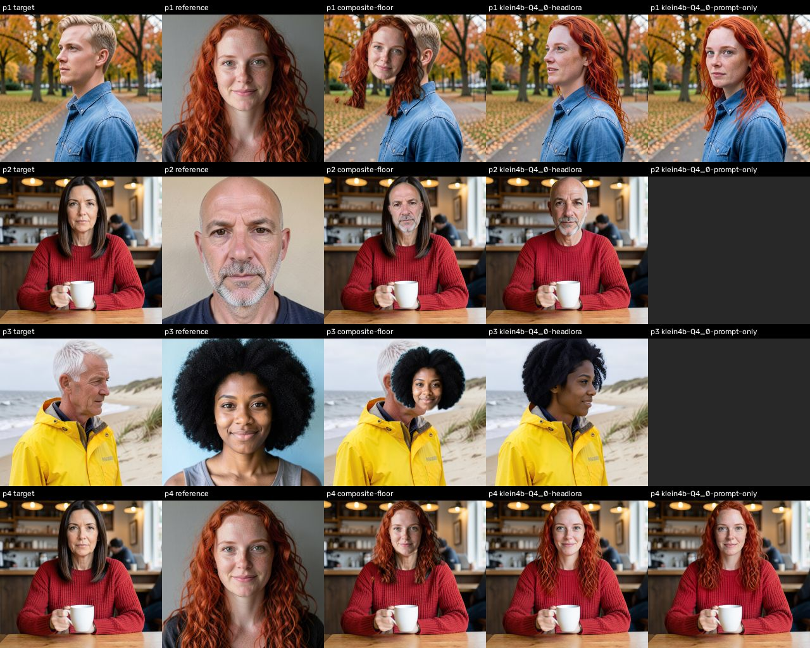

# Identity Studio: full-head replacement, measured

Unit [#470](https://github.com/LPStruiksma/atlas-gallery/issues/470) (IDS-3), goal [#467](https://github.com/LPStruiksma/atlas-gallery/issues/467). Snapshot 2026-11-18. Companions: [RESEARCH.md](RESEARCH.md), [LICENCES.md](LICENCES.md), probe tool [`tools/identity_bench/head/`](../../tools/identity_bench/head/README.md).

**Full head** here means the hair, hairline, head shape and ears change with the face. A result that changes the face and keeps the target's hair is a face swap and is reported as `face_only` everywhere in this document and in the probe. It is never counted towards full head.

Words used for evidence: **measured** (run by the probe in this unit, numbers in [`results.json`](../../tools/identity_bench/head/results/results.json)), **reported** (a paper, model card or README says so, read at the source), **community** (a third party's own measurement, not reproduced), **estimate** (arithmetic from the above, with the inputs shown).

## 1. Verdict

### (a) Local on the Galaxy S24+ today: no

Good full-head replacement does not run on the S24+ today, and the reason is compute, not a missing integration.

- The only open full-head route that produced clean results in this unit is a 4-billion-parameter image-editing model with a head-swap adapter (§5). **Measured** on 4 server CPU cores with 4-bit weights: about **15 minutes per candidate** (median 886 s) and **8.9 to 10.2 GB of memory**. **Estimate** for the S24+ CPU: **30 to 46 minutes per candidate**, so two to three hours for one edit with four candidates, with more memory than one app can hold on a 12 GB phone (§6).
- The Exynos 2400 has no public NPU path for a model of this kind (RESEARCH.md §5), so there is no accelerator to close a gap of that size. A Snapdragon phone with a hand-built NPU port runs the same model family in a few minutes per image (**community**, §6); that does not transfer to this chip.
- What does run on the phone in seconds is cutting the reference head out and pasting it on. **Measured**: it kept the old head visible in two of four cases, could not remove hair in a third, and looked acceptable only when both people faced the camera the same way (§5). That is a floor, not a feature.
- The dedicated research head swappers (GHOST 2.0, UniBioTransfer) are not lighter in any way that helps: both need a desktop GPU stack and report weaker identity than the route above (§3).

### (b) Best optional route: the same open model on a computer the user controls

**Recommended route:** FLUX.2 klein 4B with a head-swap adapter, served through the existing ATLAS self-hosted editor protocol ([`tools/ai_edit_server`](../../tools/ai_edit_server/README.md), ComfyUI or stable-diffusion.cpp behind it). The phone keeps everything except the denoising: choosing the person, picking references, cropping the head region, pasting the result back so that every pixel outside the head stays bit-identical, saving and lineage.

| Route | Cost per edit (4 candidates) | Speed | What leaves the phone | Evidence |
|---|---|---|---|---|
| **Own PC with a GPU** (8 GB VRAM or more; publisher says about 13 GB for full precision) | free | seconds per candidate (**reported** by third parties for text-to-image: about 1 to 3 s at 1024 px on RTX 4090 / 4070; the edit attends over three images, so expect a few times that; **not measured here**) | a head crop and the chosen reference crops, to the user's own machine on the home network | quality **measured** here with the same weights on CPU |
| **Own PC, CPU only** | free | about 15 min per candidate on 4 server cores (**measured**); usable as "leave it running", not interactive | same | **measured** |
| **Rented GPU, per second** (for example a 24 GB card at about USD 1.1 per hour) | about **USD 0.01 to 0.03** including a cold start (**estimate**: 4 candidates of 5 s plus 30 to 60 s start-up; `probe.cost_per_edit`) | seconds once warm | same crops, to a rented machine | price from search results, not read at the host; **spend gate** |
| **Hosted endpoint for the same model with adapters** (fal lists FLUX.2 klein 4B edit with LoRA) | about **USD 0.04 to 0.12** (**estimate** from a listed USD 0.01 per megapixel of input and output; verify on the live price card) | seconds | same crops, to a third-party processor | price from search results; **spend and upload gates** |
| **Closed multi-reference editors** already in [`PROVIDERS.md`](../ai-edit/PROVIDERS.md) (for example Gemini 3.1 Flash Image at USD 0.067 per 1K output) | about USD 0.27 | seconds | same crops, to that provider; provider policy decides what it refuses | not measured (no paid calls in this unit) |

Quality of the recommended route, **measured** on four synthetic pairs at 512 px head crops with 4-bit weights (§5): a complete head with the reference's hair in **4 of 4** cases by eye, target pose kept in 4 of 4, pixels outside the edit mask bit-identical in 4 of 4, identity confirmed by the judge in 3 of 4 (the fourth is a profile view the judge cannot read) and "convincing" by the pre-registered bar in 2 of 4. That is a working path and a clear step above the dedicated research models' reported numbers. It is not yet proof of "Retake-class": four pairs, one seed, one judge, synthetic people.

Larger open editors (Qwen-Image-Edit-2511 and Qwen-Image 2.1, 20 billion parameters, Apache-2.0, with head-swap adapters from the same author) are the likely next quality step and need a 24 GB-class GPU or a host. **Not measured here.**

Owner decisions this creates, each separate and none needed for the next unit to start: (1) whether full head may use a hosted processor at all, or only the user's own machine; (2) any spend (rented GPU or hosted endpoint).

### (c) Staged plan that keeps full head as its own objective

1. **Stage 0, now.** Local Identity Studio ships face replacement only and says so. "Replace face and hair" is offered only when a backend that can do it is connected; without one the app explains in plain words that hair and head shape need the user's computer. It never falls back to a face swap under the full-head name.
2. **Stage 1, IDS-12 (#479): optional backend.** Full head through the self-hosted protocol with the recommended model. Preconditions: the head-swap adapter's provenance is resolved or replaced by our own adapter (§4, tier D), and the content filters the FLUX.2 klein card asks deployers to add are in place. On the phone: target selection, head crop, reference crops, paste-back with a change-following mask (§5 explains why a parser mask alone is wrong), candidates by seed, lineage. Acceptance on the IDS-2 bench (#469): `full_head` class and target pose in at least 90 % of pairs, zero `face_only` results presented as full head, identity scored by at least two judges including profile views, outside-mask pixels bit-identical.
3. **Stage 2: identity and seams.** Several references per person (the model accepts up to four images; cost grows with every image), an optional local face-identity refinement on top of the generated head (the IDS-9 face engine, #475), skin-tone handling when the reference and the target differ (the neck follows the new head but hands and arms do not, §5), "Keep original expression" as an instruction.
4. **Stage 3: local stays open.** Objective: one candidate in under 60 s and under 5 GB on the phone. Blocker today: about 0.07 s per image token per step on 4 server cores, 3,072 tokens, 4 steps, and 8 to 10 GB resident. Re-test when any of these changes: a public accelerator path for the Exynos 2400 or a newer phone; a head-capable editor near 1 billion parameters or a 1-bit build with a GPU path; staged loading that frees the text encoder before denoising. Cheap check worth doing once: run the probe's 256 px smoke case on the real phone through stable-diffusion.cpp to replace the estimate in §6 with a measurement (one install, no account).

## 2. How the probe tells a head swap from a face swap

Every output gets one class from `probe.classify()`; thresholds are in `probe.py` with the date and reason for each.

| Class | Rule |
|---|---|
| `full_head` | identity moved to the reference (SFace cosine at least 0.363 and at least 0.15 above the target), the hair became the reference's, and at most 25 % of the target's own head pixels are left as they were |
| `face_only` | identity moved, hair stayed the target's |
| `target_head_remains` | a new head was added but the old one is still largely visible |
| `no_swap` | identity did not clearly move |
| `failed` | no face in the output |

"Convincing" adds: identity at least 0.60, at least 0.20 above that pair's impostor floor (reference versus target), and the head still turned the way the target's was.

Two rules were changed after the first run, and the change is recorded rather than hidden: the hair test now uses colour when everyone has hair (hair *amount* depends on framing and mis-called a clearly red-haired result), and `target_head_remains` was added because the cut-and-paste engine pasted a head beside the old one and the first rule passed it. The identity thresholds were fixed before any generative output existed.

## 3. Architectures compared

"Needs" is what the authors or model cards state. Identity numbers are each paper's own metric on its own data and are **not comparable across rows**; they are there to show the order of magnitude.

| Approach | What it is | Needs (reported) | Identity | Failure modes | Licence position |
|---|---|---|---|---|---|
| **GHOST 2.0** ([arXiv 2502.18417](https://arxiv.org/abs/2502.18417), [repo](https://github.com/ai-forever/ghost-2.0)) | Two GAN-style stages at 512: Aligner re-enacts the source head in the target pose; Blender matches skin colour and inpaints gaps. Post-processing uses a Kandinsky inpainting model | PyTorch3D, DECA, EMOCA, BlazeFace, StyleMatte, SegFormer; training 8 A100 for 27 days; no VRAM figure published | Paper: cross-reenactment CSIM 0.622. UniBioTransfer's head table (FFHQ, 987 pairs): ID sim **0.461** | Authors: "does not reproduce fine details of source appearance"; uneven skin colour when the colour reference is small; invented collars; "source hair would look unnaturally cropped from below" when the target's hair is shorter; complex lighting | Code Apache-2.0. Depends on DECA and EMOCA (research-only, register tier C). Bench only |
| **UniBioTransfer** ([arXiv 2603.19637](https://arxiv.org/abs/2603.19637), [HF](https://huggingface.co/scy639/UniBioTransfer)) | One Stable Diffusion 1.5 model with task experts for face, hair, motion and head transfer; identity from ArcFace, appearance from CLIP | "Minimum 11GB VRAM"; 512 output; 7.4 GB checkpoint | Head transfer ID sim **0.545** (best of the dedicated models in its table) | Authors: weaker on Asian faces; only the SD 1.5 backbone was tried. General editors without task training were "unstable, high-variance" in their comparison | Register tier D (MIT label, checkpoint inherits Open RAIL-M and non-commercial data). Bench only |
| **REFace** ([arXiv 2409.07269](https://arxiv.org/abs/2409.07269)) | Diffusion inpainting face swapper (Paint-by-Example derivative); head variant by enlarging the mask and retraining | SD 1.x class GPU; 50 DDIM steps | Used as the weak baseline in both HID and UniBioTransfer head tables | Works on face-centred crops; hair "cut off and not blending" (HID authors); needs retraining for head | Weights CC BY-NC 4.0 plus Open RAIL-M. Bench only |
| **HID** ([arXiv 2503.00861](https://arxiv.org/abs/2503.00861)) | SDXL with identity and hair injection (PhotoMaker V2 style) and an automatic mask from inverted noise | SDXL at 1024, 50 steps; trained on 8 A100 | Reports better head and hair LPIPS / CLIP-I than REFace; no identity cosine | Authors: regions beyond the head can change | No public weights or licence found. Not usable |
| **Identity-conditioned generators plus inpainting** (InstantID, PuLID, IP-Adapter-FaceID, InfiniteYou) | Generate a face of the person from an embedding, then inpaint it into the photo | InstantID: SDXL. PuLID-FLUX: 12 to 16 GB. InfiniteYou: 16 to 43 GB | InfiniteYou reports higher identity than PuLID-FLUX for *generation*. As a head swap (GHOST 2.0's baseline, InstantID plus SDXL inpaint): "frequently fail to preserve identity and target skin color" | The embedding carries the face, not the hair or head shape, so hair is invented from the prompt: structurally a face route | All four take identity from InsightFace `antelopev2` (research-only). InstantID checkpoints "research purposes only"; IP-Adapter-FaceID "exclusively for research"; InfiniteYou CC BY-NC 4.0. Bench only |
| **Instruction editors with a head-swap adapter** (FLUX.2 klein 4B, Qwen-Image-Edit-2511, Qwen-Image 2.1, with [BFS](https://huggingface.co/Alissonerdx/BFS-Best-Face-Swap) LoRAs) | A general image editor reads the target and the reference as pictures and redraws the head; the adapter teaches the head-swap instruction. Hair, ears and head shape come from the reference *image*, not from an embedding | klein 4B: 4 steps, about 13 GB VRAM full precision, 2.3 GB at 4-bit. Qwen editors: 20 B parameters, 24 GB-class when quantised | **Measured here** (klein 4B, 4-bit, 512 crop): median SFace cosine 0.64 to the reference, 0.72 to 0.78 on frontal pairs | **Measured**: identity softens at low resolution; the neck takes the reference's skin tone; the reference's expression leaks; the judge cannot confirm profiles; without the adapter the head turned to face the camera | klein 4B weights and Qwen3-4B encoder Apache-2.0; adapter MIT label with unstated training data, so register tier D (§4). No research-only link in the chain, but the recommended route depends on that tier-D adapter: resolving its provenance, or training our own adapter, is a precondition for IDS-12 |
| **Closed multi-reference editors** (Gemini image models and others in PROVIDERS.md) | Hosted editors that accept several reference images | Provider side | Not measured (no paid calls) | Provider refusals, no pixel fence, uploads | Provider terms; upload and spend gates |
| **3D and Gaussian head avatars** (LAM, GAGAvatar and similar) | Build an animatable 3D head from one image, render it in the target pose, then blend | LAM: about 1.4 s to build on an A100, real-time rendering, "mobile" rendering claimed | No head-swap identity numbers; these are avatar methods | They output a head on an empty background: lighting match, hair strands, neck and shoulder seam all still need a generative blender, which is the hard half of the problem | LAM Apache-2.0, GAGAvatar MIT, both built on FLAME (licence not read here: **unverified**) |
| **Cut and paste** (reference head warped onto the target) | No generation: align by landmarks, copy head pixels, feather | Milliseconds plus a segmenter | **Measured**: identity 0.79 to 0.97 because the pixels are copied | **Measured**: cannot turn the head, cannot remove the target's hair, cannot invent what was behind it; neck and lighting mismatch | Tier A parts only (with a shippable segmenter) |

Why the editor route wins: head swapping needs three things at once, namely the reference's whole appearance, the target's pose, and newly invented content where hair appears or disappears. Embedding-conditioned generators lack the first, cut-and-paste lacks the other two, and the dedicated research models have all three but were trained small (SD 1.5 class or GAN) on face-video data. A current general editor has the capacity, sees the reference as an image, and needs only a small adapter to learn the task.

## 4. Licence rows for what this unit used or recommends

In the [LICENCES.md](LICENCES.md) format, for Strategy to fold into the register (this unit does not edit that file). Read at the linked source on 2026-11-18.

| Item | Kind | Licence | Text (URL) | Public repo | Purpose limit | Use restrictions | Content checker | Consequence |
|---|---|---|---|---|---|---|---|---|
| FLUX.2 [klein] 4B (Black Forest Labs) | weights | Apache-2.0 | [model card](https://huggingface.co/black-forest-labs/FLUX.2-klein-4B) ("Open weights available for commercial use under the Apache 2.0 license") | no (7.4 GB; fetch from host) | none | none in the licence; the card states "Nothing contained in this Model Card should be interpreted as … a restriction or modification to the license" | app choice: the card says filters "must be used with the FLUX.2 [klein] 9B models" and that BFL "encourage[s] deployers to implement these mitigations when using the FLUX.2 [klein] 4B models" | **optional backend candidate**; bench |
| FLUX.2 [klein] 9B | weights | FLUX Non-Commercial License | same card | no | non-commercial | filters or manual review required | **required** | do not use (4B is the permissive one) |
| FLUX.2 klein 4B GGUF (leejet) | weights (conversion) | follows original: Apache-2.0 | [card](https://huggingface.co/leejet/FLUX.2-klein-4B-GGUF) | no | none | none | none | bench; backend |
| Qwen3-4B (text encoder) and its GGUF (unsloth) | weights | Apache-2.0 | [Qwen/Qwen3-4B](https://huggingface.co/Qwen/Qwen3-4B) | no | none | none | none | bench; backend |
| BFS head-swap LoRA `bfs_head_v1_flux-klein_4b.safetensors` | weights | MIT (card label) | [card](https://huggingface.co/Alissonerdx/BFS-Best-Face-Swap) | no | none stated | card text, not a licence clause: "Do not use or share results involving public figures or people who have not given consent" | none | **NOT VERIFIABLE — tier D; bench only**, subject to the existing [bench admission rule](LICENCES.md). No backend admission (including private, unpaid use) or distribution until provenance is resolved or a replacement is cleared. See the [provenance dossier](HEAD_ADAPTER_PROVENANCE.md) (2026-11-27) |
| stable-diffusion.cpp and its Python binding | code | MIT | [LICENSE](https://github.com/leejet/stable-diffusion.cpp/blob/master/LICENSE) | n/a | none | none | none | bench runtime; candidate backend runtime |
| `jonathandinu/face-parsing` (SegFormer) | weights | "non-commercial research and educational purposes" | [card](https://huggingface.co/jonathandinu/face-parsing) | no | research | none | none | **bench only** (judge and paste mask in the probe); a shipped paste-back uses the MediaPipe segmenters (tier A) |
| YuNet, SFace fp32 (opencv_zoo) | weights | Apache-2.0 | already in the register | yes (int8 is bundled) | none | none | none | judge |
| Qwen-Image-Edit-2511 | weights | Apache-2.0 | [card](https://huggingface.co/Qwen/Qwen-Image-Edit-2511) | no | none | none | none | later backend candidate (not run) |

## 5. Probes

**Host:** 4 virtual cores of an Intel Xeon at 2.1 GHz (AVX-512), 16 GB RAM, no GPU. This is the free cloud machine of the project. **Runtime:** stable-diffusion.cpp 0.4.7 (Python binding), FLUX.2 klein 4B `Q4_0`, Qwen3-4B `Q4_K_M`, 4 steps, guidance off. **Fixtures:** six synthetic people generated by the probe itself at 768 px from fixed prompts and seeds (three reference portraits, three waist-up targets); no real person, no licence constraint beyond Apache-2.0 on the generator. **Pairs:** four, chosen to be hard in different ways (see the sheet). **Judges:** research-only, described in the tool README.

The edit runs on a 512 px square crop around the target's head, with the reference head as the second picture, then the result is pasted back through a mask. One seed per pair.

Synthetic people only; generated by the probe; depicts no real person. Rows p1 to p4; the last column was run for p1 and p4 only.

### Results

| Engine | Pair | Class | Convincing | ID to reference | ID to target | Impostor floor | Head turn (target / result) | Old head left | Pixels changed | Seconds | Peak RSS MB |
|---|---|---|---|---|---|---|---|---|---|---|---|
| composite-floor | p1 | target_head_remains | no | 0.969 | 0.420 | 0.386 | -0.85 / -0.10 | 35% | 23% | 4 | 1902 |
| composite-floor | p2 | face_only | no | 0.792 | 0.433 | 0.412 | -0.00 / +0.02 | 42% | 6% | 3 | 2038 |
| composite-floor | p3 | target_head_remains | no | 0.932 | 0.309 | 0.294 | +0.75 / -0.03 | 32% | 16% | 3 | 2038 |
| composite-floor | p4 | full_head | yes | 0.973 | 0.417 | 0.427 | -0.00 / +0.04 | 3% | 17% | 3 | 2038 |
| klein4b-Q4_0-headlora | p1 | no_swap | no | 0.499 | 0.524 | 0.386 | -0.85 / -0.68 | 5% | 31% | 870 | 9295 |
| klein4b-Q4_0-headlora | p2 | full_head | yes | 0.723 | 0.411 | 0.412 | -0.00 / -0.04 | 2% | 25% | 904 | 10212 |
| klein4b-Q4_0-headlora | p3 | full_head | no | 0.555 | 0.309 | 0.294 | +0.75 / +0.89 | 1% | 27% | 894 | 10221 |
| klein4b-Q4_0-headlora | p4 | full_head | yes | 0.784 | 0.404 | 0.427 | -0.00 / +0.06 | 3% | 27% | 878 | 10221 |
| klein4b-Q4_0-prompt-only | p1 | full_head | no | 0.685 | 0.426 | 0.386 | -0.85 / -0.26 | 4% | 40% | 847 | 8902 |
| klein4b-Q4_0-prompt-only | p4 | full_head | yes | 0.774 | 0.355 | 0.427 | -0.00 / +0.07 | 4% | 30% | 865 | 8885 |

"Pixels changed" is the share of the whole 768 px image that differs from the source at all; every other pixel is bit-identical. Peak RSS includes the research judges loaded in the same process (the composite rows show that process without the editor: 1.9 to 2.0 GB with Python and OpenCV). Timing of the composite rows is dominated by the judge's segmenter, not by the paste.

### What the numbers and the sheet say

- **Editor with adapter (`klein4b-Q4_0-headlora`).** By eye all four are complete head replacements: the reference's hair, hairline and head shape arrive, the target's own hair is gone (1 to 5 % of the old head left), the background and clothing behind removed hair are redrawn plausibly (p2: bald head where shoulder-length hair was), and the head keeps the target's turn (largest change 0.17). The class says `full_head` for three. For p1 it says `no_swap`: the result is a near-profile and SFace scores it 0.50 to the reference and 0.52 to the target, which is the judge failing on a profile, not evidence either way. p3 is a full head with identity 0.555, below the 0.60 bar: three-quarter view, large skin-tone change.
- **Without the adapter (`prompt-only`).** Same model, same instruction. On the frontal pair it did as well. On p1 it turned the head towards the camera (head turn -0.85 to -0.26): higher identity score, wrong picture. The adapter's measurable contribution is keeping the target's pose.
- **Cut and paste (`composite-floor`).** Identity is near 1.0 because the pixels are the reference's own, and that is exactly why identity alone is a misleading metric here. It left the old head visible when the poses differed (p1, p3), could not remove the target's hair for a bald reference (p2, correctly `face_only`), and passed only on p4 where both people face the camera. Even there the full-size image shows what the metrics do not: the target's older neck under a younger face, dark hair remnants at the edge and cut hair ends. The single "convincing" is a limit of the metrics, not a result.

### Failure modes seen in this unit

- **Paste-back mask (a bug in this probe, fixed, and a requirement for IDS-12).** The first paste-back kept "everything outside the parsed head masks". The face parser misses long hair below the face, so the target's hair ends came back on top of a correct result (visible as dark strands on the sweater). The mask now also follows what the model visibly changed next to the head. A shipped paste-back needs the same rule.
- **Hair boundary.** New long hair lies over clothing and background, so the edit region is large: 25 to 31 % of the image changed in these waist-up photos.
- **Neck and skin tone.** The model repaints the neck in the reference's tone. With a different skin tone (p3) anything outside the crop, such as hands and arms, keeps the target's tone. Not visible in p3 because no hands are in frame; it will be in real photos.
- **Head scale.** Face size relative to the target ranged from 0.84 to 1.09. The afro reference came out smaller than the target's head to make room for the hair inside the crop.
- **Expression.** The instruction asks for the target's expression; on p4 the reference's slight smile came across instead.
- **Low resolution softens identity.** The 256 px smoke run aged the face visibly; identity needs the 512 px crop or more, which is what makes the compute cost.
- **Ears.** Generated plausibly where the reference showed them (p2); hidden by hair in the others. Too few cases to say more.
- **Judge.** SFace scores two *different* synthetic people at 0.29 to 0.43 (above OpenCV's published 0.363 same-person threshold) and cannot read profiles. One judge is not enough; IDS-2's three-judge plan applies.

### Timing and memory breakdown (measured)

| Workload | Image tokens | Seconds per step | Total | Peak RSS |
|---|---|---|---|---|
| Text-to-image 512 px (anchor) | 1,024 | 73.9 | 329 s | 8.0 GB |
| Text-to-image 768 px (fixtures) | 2,304 | 147 | 640 s | 10.1 GB |
| Head swap, 512 px output plus two 512 px references, with adapter | 3,072 | 207 | 886 s (median) | 9.3 to 10.2 GB |
| Head swap, same, without adapter | 3,072 | 201 | 856 s | 8.9 GB |
| Smoke: head swap at 256 px | 768 | 65 | 287 s | 8.5 GB |
| Paste-back (mask and feather, 768 px) | n/a | n/a | about 3 s, mostly the research segmenter | n/a |

Step time grows almost linearly with tokens, about 0.07 s per token per step, and four steps are the model's minimum. Text encoding and VAE work add 33 to 56 s per run. The model files total 4.9 GB on disk (2.3 GB denoiser, 2.4 GB encoder, 0.2 GB VAE); the runtime held 8 to 10 GB because it keeps everything loaded at once.

## 6. Extrapolation to the Galaxy S24+

No number below was measured on the phone.

- **Speed.** A third party measured the same denoiser on a Galaxy S25+ CPU (Snapdragon 8 Elite, stable-diffusion.cpp, 512 px text-to-image): about 114 s per step (**community**, [bonsai-image-android](https://github.com/duration-ai/bonsai-image-android), with 1-bit weights). This host ran the same workload at 73.9 s per step (**measured**), so that phone's CPU is about 1.5 times slower than this host. The Exynos 2400 scores roughly 1.45 to 1.55 times lower than the Snapdragon 8 Elite in multi-core benchmarks (search results), and sustained load throttles it; the probe uses 1.3 to 2.0. **Estimate: the S24+ CPU is 2.0 to 3.1 times slower than this host**, so one 512 px head-swap candidate takes **30 to 46 minutes** (`probe.extrapolate_phone`), and the 256 px variant that loses identity still takes about 10 to 15 minutes.
- **Accelerators.** The same community port reaches about 16 s per step on that phone's Hexagon NPU with a 6.9 GB set of device-specific binaries. The Exynos 2400 has no equivalent public path (RESEARCH.md §5); its GPU path for this runtime is untested, and on the Snapdragon phone no GPU path finished a 512 px render.
- **Memory.** Measured 8.9 to 10.2 GB resident with everything loaded. The community port reports about 5.0 GB with staged loading and a 1-bit denoiser. A 12 GB phone running a gallery cannot give one task 9 GB, and 5 GB is the edge of what is plausible. `probe.memory_fit` calls the measured figure "no".
- **Storage and heat.** 4.9 GB of weights to download, and tens of minutes at full CPU load per candidate.

So the local verdict does not depend on the uncertain parts of the estimate: even a factor of three in either direction leaves several minutes to hours per edit.

## 7a. Android HEAD engine (IDS-12C, [#479](https://github.com/LPStruiksma/atlas-gallery/issues/479))

Code: `app/src/main/java/nl/atlas/gallery/featureidentity/head/` (`HeadSwapEngine`, `SelfHostedHeadTransport`, `HeadMaskComposer`). Status: **built and JVM-tested against a fake transport only. Unavailable on every real configuration.** No UI offers it; the reveal is [#774](https://github.com/LPStruiksma/atlas-gallery/issues/774), after the real-backend verdict in [#1092](https://github.com/LPStruiksma/atlas-gallery/issues/1092).

**Gate (fail closed, checked at load).** The engine implements `IdentityEditEngine` with `mode = HEAD` only and route `SELF_HOSTED`. It loads only when all hold, else it returns the named failure and never falls back to FACE, PAID or LOCAL:

| Condition | Otherwise |
|---|---|
| The user explicitly approved a SELF_HOSTED route for whole-head edits (`HeadRouteApproval`) | ROUTE_NOT_APPROVED |
| A transport is configured and the server answers its capabilities | MODE_UNAVAILABLE |
| `provider_id` is `self-hosted-flux2-head` (never the stock `fake`, `qwen`, `flux` or `comfy` backends) and the accepted model id is listed | MODE_UNAVAILABLE |
| `features.full_head` is true, plus `mask_edit` and `seed` | MODE_UNAVAILABLE |
| `features.head_adapter.sha256` equals the adapter SHA-256 the user accepted, and `reference_images.max_count` covers the accepted reference count | MODE_UNAVAILABLE |

Today's `flux2-head` scaffold (#1017, #1063) reports `full_head: false` and no adapter hash, so the engine is unavailable. Activation needs the server to admit `full_head` and advertise `head_adapter.sha256`, which is #1090/#1092's job, not this engine's. A reply whose provider, model or adapter hash differs from the accepted identity revokes the adapter for that engine's life: the same candidate, every later "More" and any later load return MODE_UNAVAILABLE without another submit. The engine version recorded in lineage carries the first 12 hex digits of the adapter hash.

**Per candidate.** The engine grows the detected face box into a whole-head crop (face width +45% each side for ears and hair volume, face height +75% above for crown and hairline, +45% below for the neck boundary), checks it against the server's `head_width`/`head_height` and `max_output_pixels` limits and every reference against `max_input_pixels` (malformed advertised limits fail admission), and sends the full target, a prior head mask (ellipse from crown to chin plus a neck column, always inside the crop), the chosen references (up to the accepted count, at most 4) and the variation seed reduced to 0..4294967295. Lineage stores the 64-bit plan seed; the seed actually sent is its low 32 bits (`seed and 0xFFFFFFFF`), so either reproduces the request. The returned crop must be exactly crop-sized. It is pasted into a copy of the full-resolution source through a change-following mask: pixels the generated crop changed beyond noise and that connect to the head are included (so new hair outside the prior lands and old target hair is not left behind), holes are closed, and the edge is feathered down to zero at the crop border. Every pixel outside the crop, and every pixel inside with mask 0, is bit-identical to the source. The output PNG is written only in the candidate session's private workspace; the original is never touched. Cancel, cleanup, warm reuse and lineage come from `IdentityCandidateSession` unchanged.

**What this does not prove.** The JVM tests cover the gate, crop and mask geometry, reference selection, cancel, offline/error/refusal, no fallback, bit equality outside the fence and lineage. They prove nothing about photographic fidelity: head scale, hairline, neck seam and identity are measured only by the IDS-12A matrix on a real backend in #1092. No real transport over HTTP is wired yet; it belongs with activation and must keep the `AtlasProtocolProvider` rules (bearer auth, TLS off loopback, no redirects, bounded uploads, metadata-stripped uploads, single non-retried submit, server-side cancel).

## 7. What was not measured

- **GHOST 2.0 and UniBioTransfer were not run.** Both need a PyTorch stack that this machine could not install within its disk allowance (the PyPI build of PyTorch ships its GPU libraries) and a 3D-model toolchain (GHOST 2.0) or 11 GB of VRAM (UniBioTransfer). Their rows in §3 rest on their papers and repositories. The comparison "editor route beats dedicated models" therefore joins a measurement to reported numbers on different data, and should be re-checked on the IDS-2 bench if a GPU host is ever approved.
- **No GPU timing.** The seconds-per-candidate figures for a PC with a GPU are third-party text-to-image reports scaled by judgement.
- **No hosted or paid call**, no credentials, no personal image.
- **Small sample.** Four pairs, one seed each, one identity judge, synthetic people whose faces the judge separates poorly, no blinded human rating, no multi-reference profiles, no glasses, hats, children, groups or occlusion.
- **Prices** come from search-result snippets of provider pages on 2026-11-18, not from the live price cards.

## 8. Sources

- GHOST 2.0: [arXiv 2502.18417](https://arxiv.org/abs/2502.18417) (read, v4), [README](https://github.com/ai-forever/ghost-2.0/blob/main/README.md) (read), [LICENSE](https://github.com/ai-forever/ghost-2.0/blob/main/LICENSE) (read).
- UniBioTransfer: [arXiv 2603.19637](https://arxiv.org/abs/2603.19637) (read; Table 2 head transfer, Appendix E limitations, Table 6 on general editors), [HF repo](https://huggingface.co/scy639/UniBioTransfer) (read).
- HID: [arXiv 2503.00861](https://arxiv.org/abs/2503.00861) (read). REFace: [arXiv 2409.07269](https://arxiv.org/abs/2409.07269), [README](https://github.com/Sanoojan/REFace/blob/main/README.md) (read).
- InstantID [README](https://github.com/instantX-research/InstantID/blob/main/README.md), PuLID [README](https://github.com/ToTheBeginning/PuLID/blob/main/README.md), IP-Adapter-FaceID [card](https://huggingface.co/h94/IP-Adapter-FaceID), InfiniteYou [README](https://github.com/bytedance/InfiniteYou/blob/main/README.md), InsightFace [README licence](https://github.com/deepinsight/insightface/blob/master/README.md#license), EMOCA [LICENSE](https://github.com/radekd91/emoca/blob/release/EMOCA/LICENSE) (all read).
- FLUX.2 klein 4B [card](https://huggingface.co/black-forest-labs/FLUX.2-klein-4B), BFS [card](https://huggingface.co/Alissonerdx/BFS-Best-Face-Swap) and its [klein guide](https://huggingface.co/Alissonerdx/BFS-Best-Face-Swap/blob/main/docs/flux-2-klein.md), Qwen-Image-Edit-2511 [card](https://huggingface.co/Qwen/Qwen-Image-Edit-2511) (read).
- LAM [README](https://github.com/aigc3d/LAM/blob/master/README.md), GAGAvatar [README](https://github.com/xg-chu/GAGAvatar/blob/main/README.md) (read).
- On-phone timing: [duration-ai/bonsai-image-android README](https://github.com/duration-ai/bonsai-image-android/blob/main/README.md) (read; community measurement).
- Search results only (not opened at the source): GPU timings for klein 4B, rented-GPU and hosted prices, Geekbench figures for the two phone chips, and that the Retake app's privacy policy describes sending photos to third-party AI providers, which suggests it is not an on-device product.
